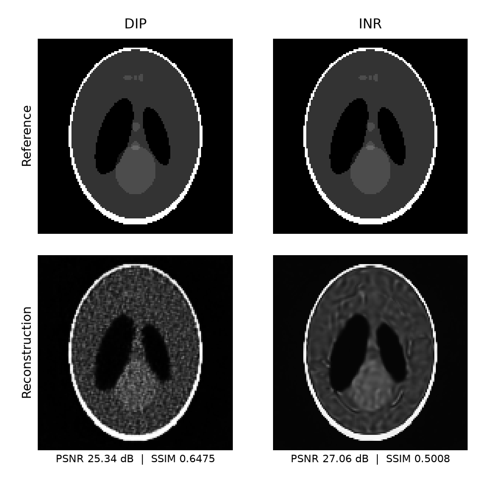
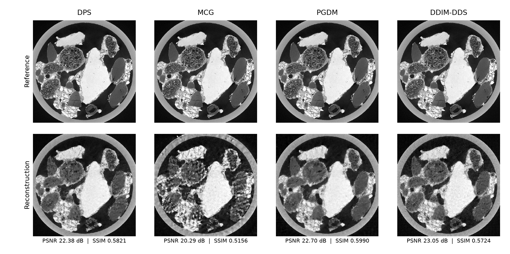
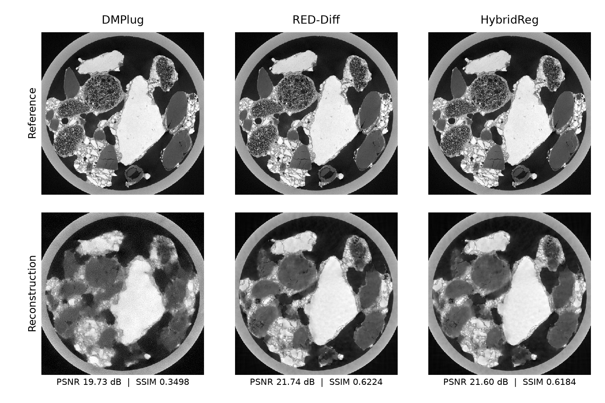
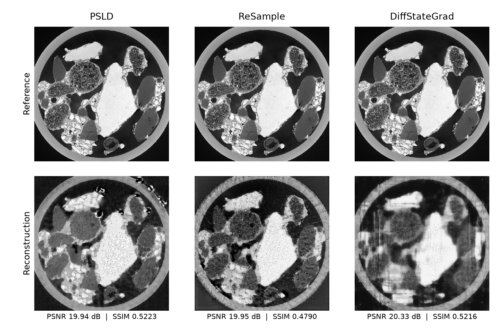
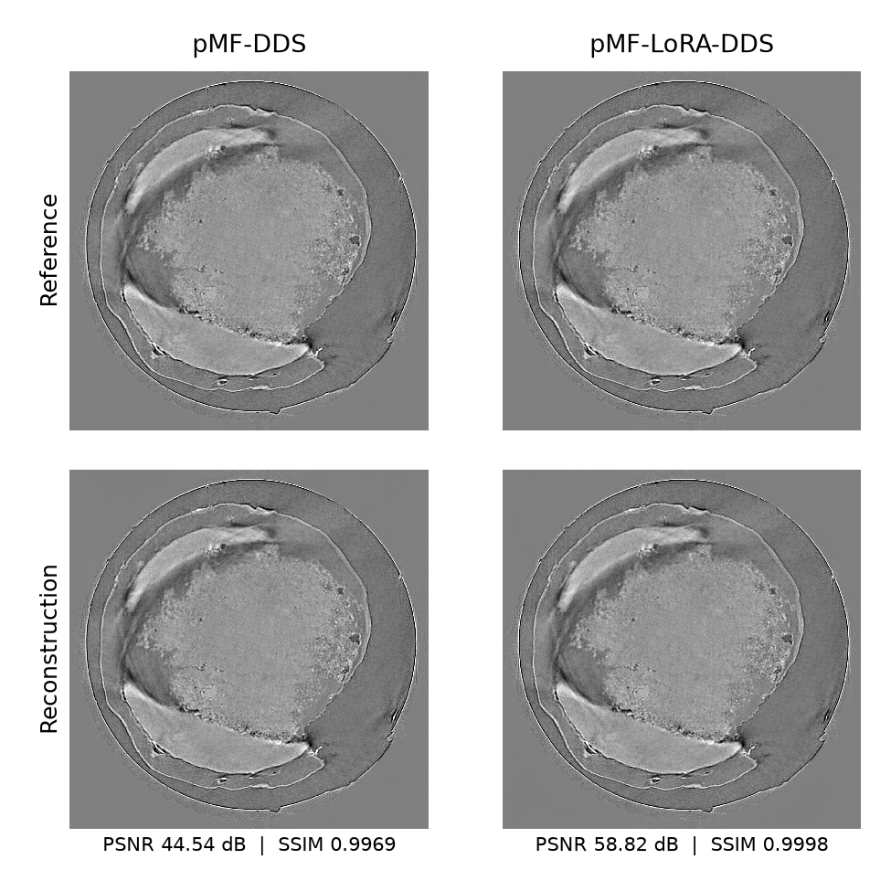

# inv_framework

**面向 CT、MRI 与反卷积的可组合逆问题算法库。**

通过统一的 Python 任务接口与配置式 runner，选择物理算子、数据保真项、正则化方法和求解器，
完成重建、数值诊断与指标评价。算法库可独立使用，也可通过 Backend／Adapter 接入 Agent 框架。

- **三域重建**：二维平行束／扇束、三维平行束／锥束 CT、多线圈 MRI、已知核与盲反卷积。
- **共享求解器**：ADMM、PDHG、FISTA 和四种线性基线，支持实数及适用的复数目标。
- **可组合正则**：TV、Haar-L1、Tikhonov、H1、梯度 Huber，以及 ADMM 的 TV＋Haar 联合目标。
- **深度先验**：DIP、INR、像素域与潜空间扩散重建、pMF mean-flow 及 LoRA 自适应。
- **工业 CT 应用**：显式探测器截断、物理几何与尺度，以及 NaSn 预处理、训练、权重导出和重建。
- **结构化接口**：能力发现、可覆盖参数、建议搜索范围、真实残差与停止状态。

[算法总览](#支持的算法) · [数据来源](#示例数据与来源) · [重建结果](#代表性重建结果) · [快速开始](#快速开始) · [Python API](#python-api) · [Agent 接入](#agent-接入)

## 支持的算法

公开任务入口由三领域实际注册表查询，方法家族与 ID 见[算法索引](docs/algorithms/README.md)。下表按算法家族列出方法；
保真项、正则和边界通过参数选择，具体组合条件由能力接口返回。

### 三域共享方法

| 方法 | 核心形式 | 主要用途 |
| --- | --- | --- |
| ADMM | 变量分裂与固定分块罚参数 | 单正则、TV＋Haar 联合重建 |
| PDHG | 原始—对偶更新 | 可分裂保真项与单正则重建 |
| FISTA | 加速近端梯度与光滑项回溯 | 光滑数据项及适用正则 |
| Landweber | 增广算子梯度迭代 | 加权最小二乘、Tikhonov／H1 |
| CGLS | 前向／伴随最小二乘共轭方向 | 实数与复数二次目标 |
| LSQR | Golub–Kahan 双对角化 | 增广最小二乘与阻尼目标 |
| CG | Hermitian 正定正规系统 | 正权重恒等 Tikhonov 重建 |

共享组合入口面向二维平行束 CT、二维 Cartesian SENSE 和已知 PSF 的二维标量反卷积。
已有领域专用入口提供下列额外方法。

### CT

| 类别 | 方法 | 适用任务 |
| --- | --- | --- |
| 解析重建 | FBP、FDK | 二维平行束／扇束、三维平行束；三维圆轨迹锥束 |
| 代数迭代 | SIRT、SART、OS-SART | 全角、稀疏角和有限角投影 |
| 统计迭代 | MLEM、OSEM | 发射计数／强度模型 |
| 专用正则化 | Tikhonov、TV-FISTA | 二次正则及 TV 重建 |
| 约束重建 | Constrained PDHG、ASD-POCS-TV | 非负图像与观测残差球约束 |
| 无预训练先验 | DIP、INR | 随机初始化网络逐例拟合二维观测 |
| 像素域扩散引导 | DPS、MCG、PGDM、DDIM-DDS | 匹配像素域去噪模型的二维 CT 重建 |
| 像素域优化 | DMPlug、RED-Diff、HybridReg | 优化初始噪声或图像，结合测量与扩散先验 |
| 潜空间扩散 | PSLD、ReSample、DiffStateGrad | 匹配 UNet 与 VQ codec 的二维重建 |
| Mean-flow 与适配 | pMF-DDS、pMF-LoRA-DDS | 2048² 单通道先验、CG 数据一致性及 LoRA 在线适配 |
| 子集预算接口 | Budgeted DPS | 调用方显式提供 source-subset 调度；公共 CT 映射支持无探测器掩膜的 Torch 平行束 |

工业几何支持独立的图像／探测器尺寸、物理间距、旋转中心和偏移，并支持非立方体体积。
深度公共任务使用 float32 的二维平行束或扇束观测；模型网格、通道、预测类型与物理尺度须匹配。
NaSn 应用提供原始投影预处理、尺度标定、训练集构建、训练恢复、EMA 导出与单切片重建。
接口与适用条件见[工业 CT](docs/ct/industrial.md)、[深度先验](docs/ct/deep_priors.md)和[NaSn 应用](docs/ct/nasn.md)。

### MRI

| 类别 | 方法 | 适用任务 |
| --- | --- | --- |
| 基础重建 | Zero-filled、CG-SENSE | 多线圈组合、SENSE 线性重建 |
| 稀疏重建 | CS-TV、CS-Wavelet | 复数 TV 与 Haar 稀疏先验 |
| 校准与插值 | ESPIRiT、GRAPPA | 灵敏度校准与 k-space 插值 |
| 学习式重建 | VarNet | 使用匹配模型权重的推理 |

### 反卷积

| 类别 | 方法 | 适用任务 |
| --- | --- | --- |
| 频域重建 | Wiener-Hunt | 已知 PSF 的二次正则化 |
| 光子计数重建 | Richardson–Lucy、RL-TV | Poisson 数据及 TV 正则 |
| 正则化重建 | TV-ADMM、Hyper-Laplacian | TV 或非凸梯度先验 |
| 盲反卷积 | Blind-DCP、Blind-L0 | 联合估计图像与模糊核 |

各算法的输入、默认值、数学定义与调用示例见[算法索引](docs/algorithms/README.md)。
数据项包括 L2、Gaussian／WLS 二次项，以及适用路径上的透射／发射 Poisson NLL。
MRI 使用复数模平方及 Hermitian 伴随；CT 透射计数与负对数投影分别处理。
正则及组合说明见[组合求解器](docs/composable_solvers.md)和[线性基线](docs/quadratic_baselines.md)。

## 示例数据与来源

### CT：合成椭圆模体

标准二维模体来自仓库收录的 **ct-ellipses-new-20261101** 数据集，包含 400 张训练图、80 张验证图和40 张测试图，
图像大小为 64×64。展示中的标准椭圆取测试集首张图，固定乘以 0.02，生成 180 角无噪投影或32 角高斯噪声投影。
联合正则示例另使用仓库随机椭圆生成函数构造六椭圆对象，固定对象种子 2026110801；32 角投影加入固定种子高斯噪声。
因此，“标准椭圆”与“随机椭圆”是不同对象。

数据位置：[原始模体](tests/data/reference_images/)、[标准案例](tests/data/cases/)、[随机椭圆示例](examples/composition/data/ct_seeded_dev/)。
观测模型与几何详见[CT 数据说明](docs/datasets.md)。

### CT：深度先验与工业示例

深度重建展示使用以下三类数据，保留各自的原始图像网格和观测条件。

| 数据 | 图像与观测 | 来源与用途 |
| --- | --- | --- |
| Shepp–Logan toy | 128×128，30角平行束，高斯噪声 σ=0.5 | 合成模体，用于 DIP／INR 逐例拟合 |
| LoDoInd toy | 512×512，40角平行束，无噪声 | LoDoInd 测试切片2750，经 DM4CT 预处理；用于像素域与潜空间先验 |
| pMF toy | 2048×2048，2048角平行束，中心512/2048列探测器有测量 | 发布 pMF 模型生成的合成电池切片，用于截断重建 |

LoDoInd 切片遵循来源 CC BY-NC 4.0 条件。pMF toy 是先验分布内的模型生成样本，其重建效果不代表真实 NaSn 扫描的泛化能力。
像素域与潜空间模型使用固定版本的 DM4CT LoDoInd UNet／VQ 权重；pMF 使用 epoch449 EMA 权重。
模型文件通过独立下载入口获取，算法运行时读取本地路径。

仓库还提供截断平行束、三维平行束、锥束及 LoDoInd／pMF 扇束数据，共八类小型示例包。
数据字段、生成方法、固定模型版本与许可见[示例数据](examples/ct_data/README.md)和[模型资源](docs/ct/deep_priors.md#模型资源)。

### MRI：MR Shepp–Logan 组织参数模体

来源为 **phantominator 0.7.0** 的 MR Shepp–Logan 模体（Gach 等，2008）。根据 M0、T1、T2 生成组织对比度，
配合四个模拟接收线圈、复数灵敏度图和 Cartesian 欠采样，形成 128×128 的开发示例。
本页两组观测使用同一对象、线圈和掩模：标准观测的噪声种子为 13000，联合重建示例的噪声种子为 0。

来源与编码约定见[公共基准数据说明](docs/public_benchmarks.md)。数据位置：[标准开发模体](tests/data/mri/cases/standard_mr_dev/)、
[固定种子联合示例](examples/composition/data/mri_standard_dev_seed0/)。

### 反卷积：camera 图像与 Levin 模糊核

清晰图像来自 **scikit-image 的 camera 图像**，摄影作者为 Lav Varshney，采用 CC0 发布版本；
模糊核来自 **Levin、Weiss、Durand、Freeman（CVPR 2009）** 的公开核，经 DPIR 核目录获取。
示例将图像转换为 256×256 浮点灰度图，使用 19×19 的 Levin 核 1 做周期卷积，再加入高斯噪声。
标准观测与联合示例使用同一清晰图和 PSF，噪声种子分别为 12000 和0。

来源与许可详见[公共基准数据说明](docs/public_benchmarks.md)。数据位置：[标准 camera 案例](tests/data/deconvolution/cases/public_camera_levin/)、
[固定种子联合示例](examples/composition/data/camera_dev_seed0/)。

## 代表性重建结果

每列上方为参考图像，下方为对应方法的重建。显示范围固定：CT 椭圆示例为 [0, 0.02]，CT 深度重建、MRI 幅值与反卷积为 [0, 1]。
指标直接在原始重建数组上计算，显示截断不参与评价。CT 使用 11×11 Gaussian 窗口 SSIM（σ=1.5、零填充、全图均值），MRI／反卷积使用7×7 uniform 窗口及边缘裁剪。
各表给出实际观测条件、迭代数和停止状态，便于按任务理解结果。不同观测条件与计算预算的示例不构成同条件排名。
完整数值和参数见[三域示例索引](docs/assets/reconstruction_examples/results.json)和[深度重建索引](docs/assets/ct_deep_results/results.json)。
深度重建采用 NVIDIA A100 80GB、float32、seed=0；PSNR／SSIM 的动态范围为各参考图的 max−min：Shepp–Logan 为1.000000、LoDoInd 为1.161286、pMF toy 为2.072266。
“固定预算完成”表示执行了指定训练或采样预算，不等同于基于阈值判定的数值收敛。

### CT：解析重建与代数迭代

FBP 使用180角无噪投影；SART 和 OS-SART 使用同一32角高斯观测，展示两轮更新的结果。

| 方法 | 数据与观测 | PSNR ↑ (dB) | SSIM ↑ | RMSE ↓ | 实际迭代 | 运行状态 |
| --- | --- | ---: | ---: | ---: | ---: | --- |
| FBP | 标准椭圆 · 密集角无噪观测 | 30.055 | 0.7409 | 0.000628 | 0 | 直接完成 |
| SART | 标准椭圆 · 稀疏角高斯观测 | 23.579 | 0.4338 | 0.001325 | 2 | 达到迭代预算 |
| OS-SART | 标准椭圆 · 稀疏角高斯观测 | 19.041 | 0.2828 | 0.002233 | 2 | 达到迭代预算 |


### CT：可组合变分重建

FISTA、PDHG 使用标准椭圆的同一32角高斯观测，Gaussian NLL、非负约束，Tikhonov 权重0.01，CUDA/float32。
ADMM 使用随机椭圆观测、L2 数据项及 TV/Haar 各0.01，CPU/float64、Cholesky 子问题。

| 方法 | 数据与观测 | PSNR ↑ (dB) | SSIM ↑ | RMSE ↓ | 实际迭代 | 运行状态 |
| --- | --- | ---: | ---: | ---: | ---: | --- |
| FISTA + Tikhonov | 标准椭圆 · 稀疏角高斯观测 | 32.319 | 0.8935 | 0.000484 | 200 | 达到迭代预算 |
| PDHG + Tikhonov | 标准椭圆 · 稀疏角高斯观测 | 24.837 | 0.7876 | 0.001146 | 200 | 达到迭代预算 |
| ADMM + TV + Haar | 随机椭圆 · 稀疏角高斯观测 | 35.699 | 0.9918 | 0.000328 | 1427 | 收敛 |


### CT：DIP 与 INR

两种方法使用同一128²模体和30角高斯观测。DIP 优化3000次，lr=0.001、输入通道32、EMA=0.99；INR 优化2000次，lr=0.0001、SIREN 隐层宽度256、隐层数4。

| 方法 | 数据与观测 | PSNR ↑ (dB) | SSIM ↑ | RMSE ↓ | 实际迭代 | 运行状态 |
| --- | --- | ---: | ---: | ---: | --- | --- |
| DIP | Shepp–Logan 128² · 30角高斯观测 | 25.341 | 0.6475 | 0.054067 | 3000次优化 | 固定预算完成 |
| INR | Shepp–Logan 128² · 30角高斯观测 | 27.057 | 0.5008 | 0.044375 | 2000次优化 | 固定预算完成 |



### CT：像素域扩散引导

使用同一 LoDoInd 512²切片、40角无噪观测和发布像素域 UNet。DPS／MCG 分别使用1000步、引导强度1／2；PGDM 使用100步、引导强度0.3；MCG／PGDM 的 SIRT 伪逆预算为100次。DDIM-DDS 使用100步、η=0.85、每步 CG 上限5次、γ=0。

| 方法 | 数据与观测 | PSNR ↑ (dB) | SSIM ↑ | RMSE ↓ | 实际迭代 | 运行状态 |
| --- | --- | ---: | ---: | ---: | --- | --- |
| DPS | LoDoInd 512² · 40角无噪观测 | 22.383 | 0.5821 | 0.088267 | 1000步采样 | 固定预算完成 |
| MCG | LoDoInd 512² · 40角无噪观测 | 20.292 | 0.5156 | 0.112287 | 1000步采样 | 固定预算完成 |
| PGDM | LoDoInd 512² · 40角无噪观测 | 22.703 | 0.5990 | 0.085070 | 100步采样 | 固定预算完成 |
| DDIM-DDS | LoDoInd 512² · 40角无噪观测 | 23.046 | 0.5724 | 0.081780 | 100步采样 | 固定预算完成 |



### CT：像素域优化

使用同一 LoDoInd 观测和像素域先验。DMPlug 优化1000轮，每轮3步 DDIM，lr=0.005。RED-Diff／HybridReg 使用200个噪声等级、lr=0.099、σ=0.0001、测量／噪声损失权重0.5／10000和100次 SIRT；HybridReg 的 β=0.9999。

| 方法 | 数据与观测 | PSNR ↑ (dB) | SSIM ↑ | RMSE ↓ | 实际迭代 | 运行状态 |
| --- | --- | ---: | ---: | ---: | --- | --- |
| DMPlug | LoDoInd 512² · 40角无噪观测 | 19.732 | 0.3498 | 0.119765 | 1000轮 × 3步采样 | 固定预算完成 |
| RED-Diff | LoDoInd 512² · 40角无噪观测 | 21.745 | 0.6224 | 0.094997 | 200次优化 | 固定预算完成 |
| HybridReg | LoDoInd 512² · 40角无噪观测 | 21.602 | 0.6184 | 0.096565 | 200次优化 | 固定预算完成 |



### CT：潜空间扩散

使用同一 LoDoInd 观测和发布的潜空间 UNet／VQ codec。PSLD 使用1000步、γ=0.8、ω=0.2、η=0及100次 SIRT。ReSample／DiffStateGrad 使用200个基础采样步，像素／潜空间学习率0.0001／0.1、内层上限2000／500；DiffStateGrad 的方差截断为0.99、子空间更新周期为1。

| 方法 | 数据与观测 | PSNR ↑ (dB) | SSIM ↑ | RMSE ↓ | 实际迭代 | 运行状态 |
| --- | --- | ---: | ---: | ---: | --- | --- |
| PSLD | LoDoInd 512² · 40角无噪观测 | 19.939 | 0.5223 | 0.116944 | 1000步采样 | 固定预算完成 |
| ReSample | LoDoInd 512² · 40角无噪观测 | 19.951 | 0.4790 | 0.116783 | 200步采样 | 固定预算完成 |
| DiffStateGrad | LoDoInd 512² · 40角无噪观测 | 20.334 | 0.5216 | 0.111753 | 200步采样 | 固定预算完成 |



### CT：Mean-flow 与 LoRA

使用发布 pMF epoch449 EMA 权重和2048²合成参考图，2048角投影仅测量中心512列。两种方法均使用16步、每步 CG 上限10次、λ=5、η=0、ω=1；LoRA 秩为8、适配学习率0.0001、每步更新4次。参考图由同一先验生成，高指标对应分布内合成数据，不代表真实 NaSn 扫描效果。

| 方法 | 数据与观测 | PSNR ↑ (dB) | SSIM ↑ | RMSE ↓ | 实际迭代 | 运行状态 |
| --- | --- | ---: | ---: | ---: | --- | --- |
| pMF-DDS | pMF 合成图 2048² · 截断投影 | 44.543 | 0.9969 | 0.012283 | 16步采样 | 固定预算完成 |
| pMF-LoRA-DDS | pMF 合成图 2048² · 截断投影 | 58.817 | 0.9998 | 0.002375 | 16步采样 | 固定预算完成 |



### MRI：多线圈与稀疏重建

Zero-filled 与 CS-TV 使用标准观测，CS-TV 权重为0.005；ADMM 联合重建使用固定种子观测，TV/Haar 权重各0.01。
重建保存为 complex128，表中指标及图像采用幅值。

| 方法 | 数据与观测 | PSNR ↑ (dB) | SSIM ↑ | RMSE ↓ | 实际迭代 | 运行状态 |
| --- | --- | ---: | ---: | ---: | ---: | --- |
| Zero-filled | MR 标准模体 · 标准噪声观测 | 25.438 | 0.5555 | 0.053467 | 0 | 直接完成 |
| CS-TV | MR 标准模体 · 标准噪声观测 | 37.908 | 0.9864 | 0.012724 | 60 | 达到迭代预算 |
| ADMM + TV + Haar | MR 标准模体 · 固定种子观测 | 35.080 | 0.9818 | 0.017620 | 386 | 收敛 |


### 反卷积：频域与正则化重建

Wiener-Hunt 与 TV-ADMM 使用标准 camera 观测；ADMM 联合重建使用固定种子观测，TV/Haar 权重各0.01。
三者均使用已知核和周期卷积；联合重建通过 FFT 求解可同时对角化的子问题。

| 方法 | 数据与观测 | PSNR ↑ (dB) | SSIM ↑ | RMSE ↓ | 实际迭代 | 运行状态 |
| --- | --- | ---: | ---: | ---: | ---: | --- |
| Wiener-Hunt | camera / Levin 核 · 标准噪声观测 | 29.619 | 0.8448 | 0.033042 | 0 | 直接完成 |
| TV-ADMM | camera / Levin 核 · 标准噪声观测 | 28.682 | 0.8139 | 0.036802 | 200 | 达到迭代预算 |
| ADMM + TV + Haar | camera / Levin 核 · 固定种子观测 | 25.683 | 0.7473 | 0.051981 | 551 | 收敛 |


## 快速开始

### 安装

Python 3.10 或更高版本。从源码安装基础依赖：

```bash
git clone https://github.com/apricity093/imaging-lab.git
cd imaging-lab
python -m pip install -e ".[dev]"
```

| 运行路径 | 设备与依赖 |
| --- | --- |
| 三域附带示例 | CPU，基础 NumPy／SciPy／PyTorch 依赖 |
| CT Torch | CPU 或支持 CUDA 的 PyTorch |
| CT ASTRA／FDK | ASTRA；FDK 使用 ASTRA CUDA 与 PyTorch CUDA |
| CT LEAP 接口 | LLNL LEAP，按安装配置选择设备 |
| CT DIP／INR | 基础 PyTorch 依赖，无需预训练权重；按任务选择 CPU／CUDA |
| CT 像素域／潜空间扩散 | `pip install -e ".[diffusion]"`，匹配 UNet／scheduler 及所需 VQ codec |
| pMF／NaSn | `pip install -e ".[nasn]"`，匹配 pMF 权重；NaSn 投影需 CUDA Toolkit、C++ 编译器和 Ninja |
| NaSn 训练 | `pip install -e ".[nasn,nasn-train]"`，训练数据及所选损失网络资源 |
| 非 Cartesian MRI 专用入口 | `pip install -e ".[mri]"` |
| VarNet | 匹配的本地模型权重，可选 CPU／CUDA |
| 重新生成公共模体 | `pip install -e ".[benchmark-data]"` |

使用已附带数据可直接运行示例。完整环境配置见[依赖与安装](DEPENDENCIES.md)。
Windows Conda 用户可在已激活环境中设置：

```powershell
$env:PATH = "$env:CONDA_PREFIX/Library/bin;$env:CONDA_PREFIX;" + $env:PATH
$env:OMP_NUM_THREADS = '1'
$env:MKL_NUM_THREADS = '1'
```

### 运行三域联合重建

从仓库根目录执行，每次运行使用独立输出目录：

```bash
python -m inv_framework.runner --config examples/composition/ct_tv_haar.yaml --output outputs/demo/ct
python -m inv_framework.runner --config examples/composition/mri_tv_haar.yaml --output outputs/demo/mri
python -m inv_framework.runner --config examples/composition/deconvolution_tv_haar.yaml --output outputs/demo/deconvolution
```

三个配置使用 ADMM、TV/Haar 权重各0.01、固定分块 rho=1、外层上限2000与容差1e-5。
CT 示例采用64×64双精度 Cholesky；MRI 采用复数 CG；反卷积采用周期 FFT。
参数起点、数组键与其他方法切换见[组合示例](examples/composition/README.md)。

### CT 命令行

```bash
invct list-solvers --json
invct data list
invct run fbp --case parallel_2d__ellipses_dense_clean --config configs/algorithms/fbp.yaml --out outputs/demo/fbp --device cpu
invct run fdk --case cone_3d/spheres_astra_12 --config configs/algorithms/fdk.yaml --out outputs/demo/fdk --device cuda
```

`invct run` 使用算法 YAML；三域统一 runner 使用包含 modality、algorithm、inputs、model、params 的实验配置。
CT 案例可通过 `--data-root` 指定数据根目录；外部观测也可直接通过任务 API 提交。

### CT 深度重建

安装扩散依赖并准备像素域权重后，可直接运行附带的 LoDoInd 示例。模型与输出目录使用仓库外的工作路径。

```bash
python -m pip install -e ".[diffusion]"
inv-download-weights lodoind-pixel --output /path/to/weights
python -m examples.run_deep_ct --algorithm ddim_dds \
  --input examples/ct_data/toy_lodoind_512.npz \
  --weights /path/to/weights/lodoind_pixel_diffusion \
  --device cuda --output /path/to/runs/ddim_dds
```

`lodoind-latent` 下载潜空间 UNet、scheduler 和 VQ codec；`pmf` 下载 pMF 权重与相邻 JSON 配置。
DIP／INR 不需要 `--weights`。`--params` 接受 JSON 参数覆盖，未指定的参数沿用算法默认配置。
文件任务模板见[CT 资源与调用](docs/ct/resources.md)，NaSn 数据处理、训练及重建命令见[NaSn 应用](docs/ct/nasn.md)。

## Python API

统一配置入口适用于三个领域，并支持显式参数覆盖：

```python
from inv_framework.runner import run_experiment

result = run_experiment(
    "examples/composition/mri_tv_haar.yaml",
    output_dir="outputs/demo/mri_python",
    params={"strength": 0.005, "num_iterations": 500},
)
print(result.status, result.converged, result.stopping_reason)
print(result.effective_params)
image = result.outputs["reconstruction"]
```

各领域也提供直接任务接口：

| 领域 | 请求与执行接口 |
| --- | --- |
| CT | `inv_framework.ct.api.CTTaskRequest` / `run_ct_task` |
| MRI | `inv_framework.mri.api.MRITaskRequest` / `run_mri_task` |
| 反卷积 | `inv_framework.deconvolution.api.DeconvolutionTaskRequest` / `run_deconvolution_task` |

能力查询返回算法、输入条件、默认值、建议范围和组合要求：

```python
from inv_framework.mri.api import list_capabilities

capabilities = list_capabilities(context={
    "model": {"sampling": "cartesian", "spatial_shape": [128, 128]},
})
print([item["name"] for item in capabilities["algorithms"]])
```

参数优先级为 **算法默认配置 < 实验文件参数 < 函数显式参数**。
建议搜索范围供任务选参使用，数学合法域由公开入口校验。自动步长根据实际算子、目标及适用回溯规则确定。
接口细节见[公开 API](docs/agent_algorithm_api.md)、[参数说明](docs/parameter_search.md)。

CT 深度任务通过相同入口执行。DIP／INR 的外层预算为 `num_iterations`，扩散与 pMF 为 `num_inference_steps`，
DMPlug 为 `epochs`；CG、LoRA 及潜空间内优化使用独立参数。
`image_scale` 与 `image_offset` 声明模型域到物理域的转换，公共输出恢复为物理域。

## 输出与评价

统一 runner 保存：

```text
run-directory/
├── result.json          # 有效参数、指标、残差、轨迹与停止原因
└── reconstruction.npy   # 实数或复数重建数组
```

CT 的 `invct run` 保存 tensor bundle、指标和诊断，支持离线复评：

```bash
invct eval --run outputs/demo/fbp --protocol configs/protocols/traditional_quality.yaml
```

`status` 表示执行结果，`converged` 与 `stopping_reason` 表示数值停止状态。
直接重建标记完成，迭代方法分别记录收敛、预算结束和精度停止。评价参考在重建返回后使用；
PSNR、SSIM 与 RMSE 采用任务给定的固定 data_range，MRI 幅值与复数指标分别表达。

## Agent 接入

Agent 通过能力接口发现输入要求与参数，再通过公开任务入口执行确定的重建问题。
算法库独立于 Agent SDK，框架接入层负责请求映射、预算、执行传输及结果组织。

```text
Agent 请求 → Backend / Adapter → 算法库任务 API → 求解器 → 重建与数值诊断
```

上层框架获取本仓库源码后，通过 `inv_framework.capabilities.list_capabilities` 查询三领域能力，
使用领域 API 或 `run_experiment` 执行任务。能力记录包含几何、设备、权重、参数约束与原生预算字段；
上层负责数据与模型暂存、设备选择和预算调度，评价参考仅用于重建后的独立评价。
详见[Agent 接口说明](docs/agent_algorithm_api.md)和[Harness 调用契约](docs/ct/harness.md)。

## 项目结构

```text
imaging-lab/
├── inv_framework/
│   ├── api/                     # CT 请求校验、分发与 CLI
│   ├── core/                    # 算子、保真项、正则与共享数值原语
│   ├── ct/                      # CT 公共入口、几何、数据与深度任务适配
│   │   └── backends/            # Torch、ASTRA、LEAP、NaSn 和 CUDA 源码
│   ├── mri/                     # MRI 公共入口、编码、校准与重建
│   ├── deconvolution/           # 反卷积公共入口、已知核与盲估计
│   ├── solvers/                 # 经典、统计、变分与组合求解器
│   │   └── deep/                # DIP、INR 与深度方法注册
│   │       ├── diffusion/       # 扩散、mean-flow、conditioning 与 LoRA
│   │       └── models/          # SIREN、UNet、VQ、pMF 与权重加载
│   ├── applications/
│   │   └── nasn_ct/             # NaSn 预处理、训练恢复、导出与重建 CLI
│   ├── evaluation/              # 独立数组评价
│   ├── capabilities.py          # 三领域聚合能力查询
│   ├── experiments.py           # 统一实验配置与结果契约
│   └── runner.py                # 三领域统一执行与文件入口
├── configs/
│   ├── algorithms/              # CT 算法默认参数
│   ├── ct/                      # 工业与深度 CT 请求模板
│   ├── mri/                     # MRI 配置
│   └── deconvolution/           # 反卷积配置
├── examples/
│   ├── ct_data/                 # 八类 CT toy 数据及来源说明
│   ├── composition/             # 三领域组合重建示例
│   └── run_deep_ct.py           # 深度 CT 示例入口
├── tests/                       # 数学、接口、领域与应用回归
├── docs/
│   ├── algorithms/              # 方法说明、来源卡片与参数
│   ├── ct/                      # CT、深度先验、NaSn 与调用约定
│   ├── mri/                     # MRI 领域手册
│   ├── deconvolution/           # 反卷积领域手册
│   └── assets/                  # 展示图与指标索引
└── tools/                       # 数据生成、模型下载与文档生成
```

## 开发与文档

```bash
python -m pytest -q
```

测试覆盖算子伴随、独立数值参考、参数传递、公开任务及资源管理；可选后端根据安装与设备条件运行。
具体测试入口和数值适用说明见[验证说明](docs/validation.md)。

- [算法索引](docs/algorithms/README.md)
- [架构与术语](docs/architecture.md)
- [算法来源与实现差异](docs/source_references.md)
- [CT 数据与几何](docs/datasets.md)
- [MRI／反卷积数据来源](docs/public_benchmarks.md)
- [组合求解器](docs/composable_solvers.md)
- [线性基线](docs/quadratic_baselines.md)
- [参数与搜索建议](docs/parameter_search.md)
- [独立运行示例](examples/composition/README.md)
- [工业 CT 与模型资源](docs/ct/resources.md)
- [CT 深度先验](docs/ct/deep_priors.md)
- [NaSn 应用](docs/ct/nasn.md)

## 许可证

项目采用 [MIT 许可证](LICENSE)。外部后端、图像、模体生成器与模型权重遵循各自许可；
第三方来源及说明见 [THIRD_PARTY_NOTICES.md](THIRD_PARTY_NOTICES.md) 和[数据来源说明](docs/public_benchmarks.md)。
