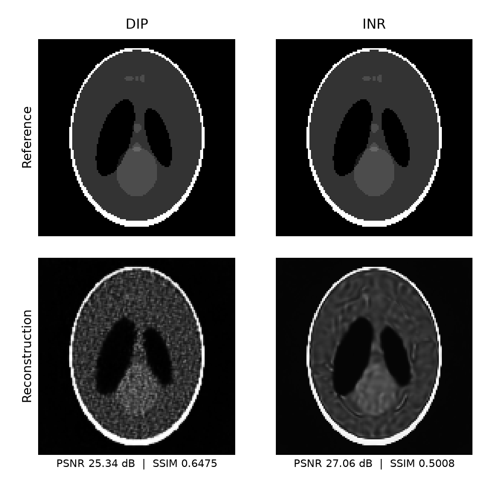
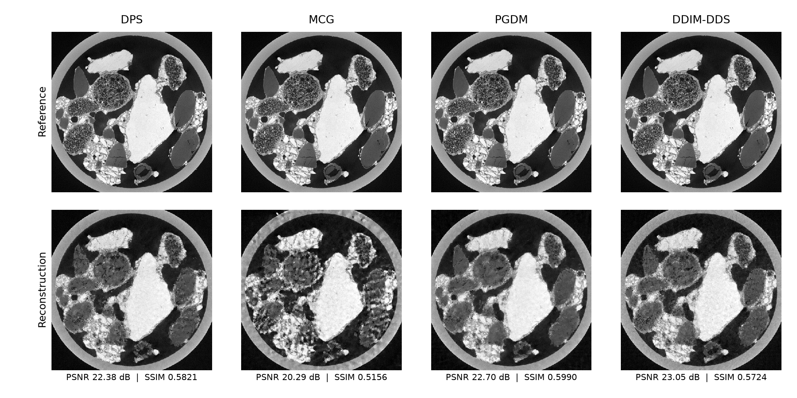
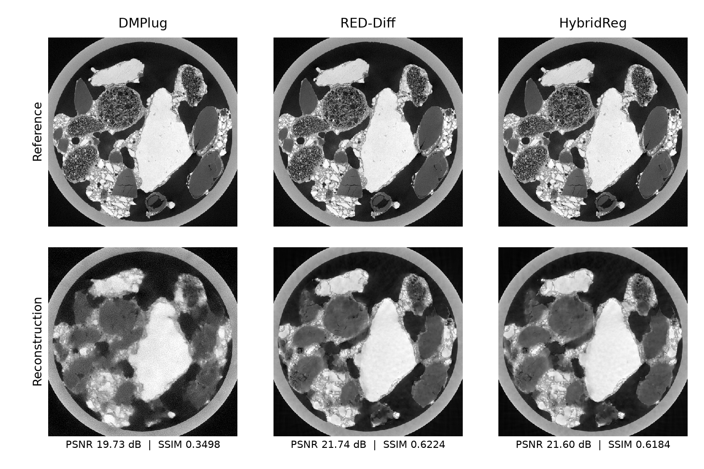
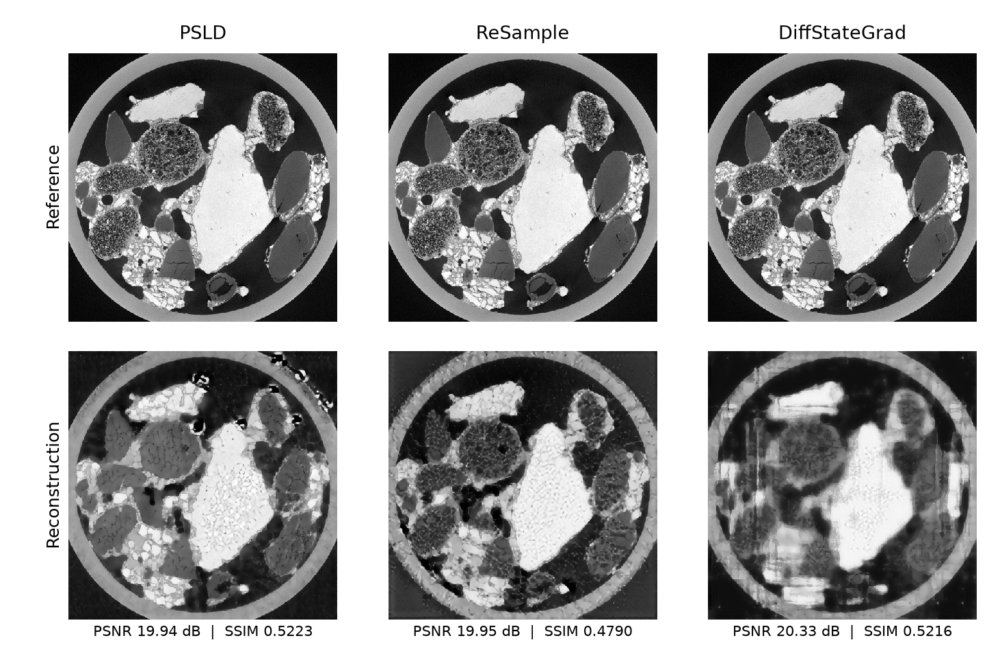
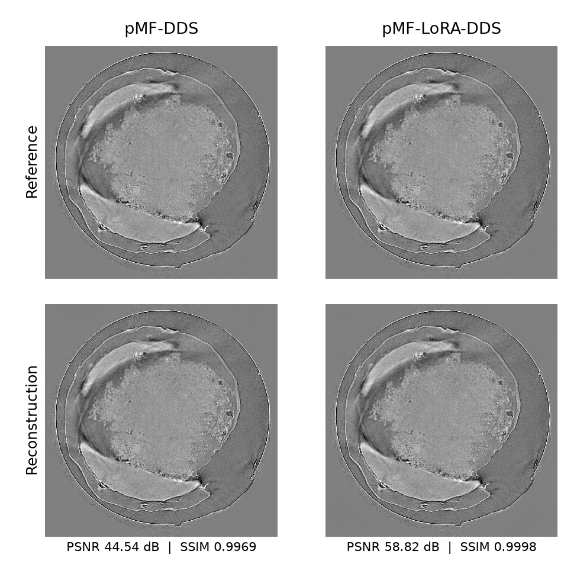

# CT 深度重建结果

14个新增深度方法均按来源推荐配置、固定 seed=0，在服务器重新运行一次。相较此前约两步的流程基线，全部方法的 PSNR 和两套 SSIM 均改善；本轮没有进行额外参数搜索或修改算法来优化分数。

运行环境为 NVIDIA A100 80GB、float32。各方法计算预算不同，结果不构成同计算量排名。实际状态均为 success、fixed_budget_completed、converged=false；这里的“固定预算完成”表示执行结束，原生流程未据此作出数值收敛判断。

## 与短预算基线和来源记录对照

下表采用未裁剪的物理域图像。来源及本次的 SSIM₇ 均为 skimage 默认7×7 uniform窗口的完整 scoremap 均值。来源数值来自[算法结果清单](https://github.com/peterw634/inv_framework/blob/dc181fb65afbf300a9935c3c770231c44ffc0c78/algorithms/results.json)，保留其原环境；接近来源记录不等同于跨环境逐值一致。

| 方法 | 短预算 PSNR | 推荐配置 PSNR | 来源 PSNR | 本次 SSIM₇ | 来源 SSIM₇ |
| --- | ---: | ---: | ---: | ---: | ---: |
| DIP | 7.27 | 25.34 | 25.81 | 0.6391 | 0.6556 |
| INR | 8.72 | 27.06 | 27.09 | 0.4902 | 0.4949 |
| DPS | 11.84 | 22.38 | 22.25 | 0.5816 | 0.5791 |
| MCG | 12.95 | 20.29 | 20.35 | 0.5029 | 0.5018 |
| PGDM | 13.35 | 22.70 | 22.72 | 0.5964 | 0.6005 |
| DDIM-DDS | 18.98 | 23.05 | 23.05 | 0.5684 | 0.5684 |
| DMPlug | 11.46 | 19.73 | 19.83 | 0.3448 | 0.3666 |
| RED-Diff | 19.62 | 21.74 | 21.74 | 0.6178 | 0.6178 |
| HybridReg | 12.62 | 21.60 | 21.60 | 0.6130 | 0.6130 |
| PSLD | 11.10 | 19.94 | 19.44 | 0.5083 | 0.4906 |
| ReSample | 10.68 | 19.95 | 19.89 | 0.4642 | 0.4665 |
| DiffStateGrad | 10.68 | 20.33 | 20.44 | 0.5037 | 0.5103 |
| pMF-DDS | 23.50 | 44.54 | 44.54 | 0.9962 | 0.9962 |
| pMF-LoRA-DDS | 23.67 | 58.82 | 59.17 | 0.9998 | 0.9998 |

PSNR 单位为 dB。基线为 DIP/INR 的2次优化、扩散的2步采样及 DMPlug 的1轮×2步；新结果使用下列来源推荐预算。完整前后指标、实际参数、内层更新和服务器路径见[结果索引](../assets/ct_deep_results/results.json)。

## 图像与评价口径

每列上方为参考图像，下方为推荐配置的重建，统一按灰度 [0, 1] 显示。显示截断不参与指标计算。下方分组表和图注沿用 README 的 CT 口径：11×11 Gaussian窗口（σ=1.5、零填充、全图均值）的 SSIM₁₁。PSNR、SSIM和RMSE均在保存的原数组上离线计算，不做强度拟合、裁剪或重建后处理；参考图不进入重建参数或初始化。

动态范围固定为数据包参考图的 max−min：Shepp–Logan 为1.000000，LoDoInd 为1.161286，pMF合成图为2.072266。不同数据集的指标不能直接比较，SSIM₇与SSIM₁₁也不混用。

## DIP 与 INR

DIP 使用3000次 Adam 更新、lr=0.001、32个输入通道和 EMA=0.99。INR 使用2000次更新、lr=0.0001、256宽和4层 SIREN。数据为 toy_parallel_ct_128.npz，30角平行束观测含 σ=0.5 高斯噪声。当前两者均为单样本；旧 INR 基线取原 batch 的第一个样本。

| 方法 | 数据与观测 | PSNR ↑ (dB) | SSIM₁₁ ↑ | RMSE ↓ | 实际迭代 | 运行状态 |
| --- | --- | ---: | ---: | ---: | --- | --- |
| DIP | Shepp–Logan 128² · 30角高斯观测 | 25.341 | 0.6475 | 0.054067 | 3000次优化 | 固定预算完成 |
| INR | Shepp–Logan 128² · 30角高斯观测 | 27.057 | 0.5008 | 0.044375 | 2000次优化 | 固定预算完成 |

## 像素域扩散引导

同一 LoDoInd 切片、40角平行束无噪观测与发布像素域 UNet。DPS：1000步、scale=1；MCG：1000步、scale=2、SIRT=100；PGDM：100步、scale=0.3、SIRT=100；DDIM-DDS：100步、η=0.85、CG内层上限5次、γ=0。

| 方法 | 数据与观测 | PSNR ↑ (dB) | SSIM₁₁ ↑ | RMSE ↓ | 实际迭代 | 运行状态 |
| --- | --- | ---: | ---: | ---: | --- | --- |
| DPS | LoDoInd 512² · 40角无噪观测 | 22.383 | 0.5821 | 0.088267 | 1000步采样 | 固定预算完成 |
| MCG | LoDoInd 512² · 40角无噪观测 | 20.292 | 0.5156 | 0.112287 | 1000步采样 | 固定预算完成 |
| PGDM | LoDoInd 512² · 40角无噪观测 | 22.703 | 0.5990 | 0.085070 | 100步采样 | 固定预算完成 |
| DDIM-DDS | LoDoInd 512² · 40角无噪观测 | 23.046 | 0.5724 | 0.081780 | 100步采样 | 固定预算完成 |

## 像素域优化方法

数据和模型与上一组相同。DMPlug 优化1000轮，每轮3步 DDIM，lr=0.005。RED-Diff、HybridReg 均为200个噪声等级、lr=0.099、σ=0.0001、测量/噪声损失权重0.5/10000、SIRT=100；HybridReg 的 β=0.9999。

| 方法 | 数据与观测 | PSNR ↑ (dB) | SSIM₁₁ ↑ | RMSE ↓ | 实际迭代 | 运行状态 |
| --- | --- | ---: | ---: | ---: | --- | --- |
| DMPlug | LoDoInd 512² · 40角无噪观测 | 19.732 | 0.3498 | 0.119765 | 1000轮 × 3步采样 | 固定预算完成 |
| RED-Diff | LoDoInd 512² · 40角无噪观测 | 21.745 | 0.6224 | 0.094997 | 200次优化 | 固定预算完成 |
| HybridReg | LoDoInd 512² · 40角无噪观测 | 21.602 | 0.6184 | 0.096565 | 200次优化 | 固定预算完成 |

## 潜空间扩散

使用发布潜空间 UNet/VQ codec。PSLD：1000步、γ=0.8、ω=0.2、η=0、SIRT=100。ReSample、DiffStateGrad：200步、pixel_lr=0.0001、latent_lr=0.1、inter_timesteps=5，像素/潜空间内优化上限2000/500；DiffStateGrad 另设 var_cutoff=0.99、period=1。两种重采样方法实际各调用去噪网络265次，并各完成7×2000次像素优化；潜空间实际更新分别1835、1321次，保留原生提前停止条件。

| 方法 | 数据与观测 | PSNR ↑ (dB) | SSIM₁₁ ↑ | RMSE ↓ | 实际迭代 | 运行状态 |
| --- | --- | ---: | ---: | ---: | --- | --- |
| PSLD | LoDoInd 512² · 40角无噪观测 | 19.939 | 0.5223 | 0.116944 | 1000步采样 | 固定预算完成 |
| ReSample | LoDoInd 512² · 40角无噪观测 | 19.951 | 0.4790 | 0.116783 | 200步采样 | 固定预算完成 |
| DiffStateGrad | LoDoInd 512² · 40角无噪观测 | 20.334 | 0.5216 | 0.111753 | 200步采样 | 固定预算完成 |

## Mean-flow 与 LoRA

使用来源 toy_nasn_pmf_2048.npz，2048角平行束、2048列探测器，中心512列有测量。参考图由同一发布 pMF 先验生成，属于分布内合成样本，不是实测 NaSn 扫描。两种方法使用 epoch449 EMA、原2048²网格、16步 mean-flow、CG内层上限10次、λ=5、η=0、ω=1。LoRA 秩为8、适配学习率0.0001，每步更新4次，共64次。

| 方法 | 数据与观测 | PSNR ↑ (dB) | SSIM₁₁ ↑ | RMSE ↓ | 实际迭代 | 运行状态 |
| --- | --- | ---: | ---: | ---: | --- | --- |
| pMF-DDS | pMF 合成图 2048² · 截断投影 | 44.543 | 0.9969 | 0.012283 | 16步采样 | 固定预算完成 |
| pMF-LoRA-DDS | pMF 合成图 2048² · 截断投影 | 58.817 | 0.9998 | 0.002375 | 16步采样 | 固定预算完成 |

中心半径256像素的圆形 ROI 另计：pMF-DDS 为 63.47 dB / SSIM₇ 0.999786，pMF-LoRA-DDS 为 68.06 dB / SSIM₇ 0.999924。这些 ROI 指标与上表全图指标分别表达，高指标不能外推为真实扫描的泛化效果。

## 数据与结果位置

- 数据生成、处理和许可见[示例数据说明](../../examples/ct_data/README.md)。LoDoInd 图像沿用 CC BY-NC 4.0 条件；pMF 参考图为模型生成样本。
- 模型版本、物理域转换和独立调用见[深度先验](deep_priors.md)。本轮主要调整是恢复来源的训练、采样和内层一致性预算，没有将参数修改写回算法默认配置。
- 新运行位于服务器 `/home/gaodongxu/autodl-tmp/imaging-lab/runs/parameter_comparison/<algorithm>/`，原短预算基线保留在 `runs/public/<algorithm>/`。新目录中的 comparison.json、execution.json、result.json 和 reconstruction.npy 保存实际证据。耗时含模型加载，离线评价另算；GPU选择随空闲情况变化，时间不用于性能排名。
- 本页只保留展示图和小型指标索引，不将权重或原始重建数组加入算法库。Budgeted DPS 按方案只迁入代码与接口，不列入效果实验。
